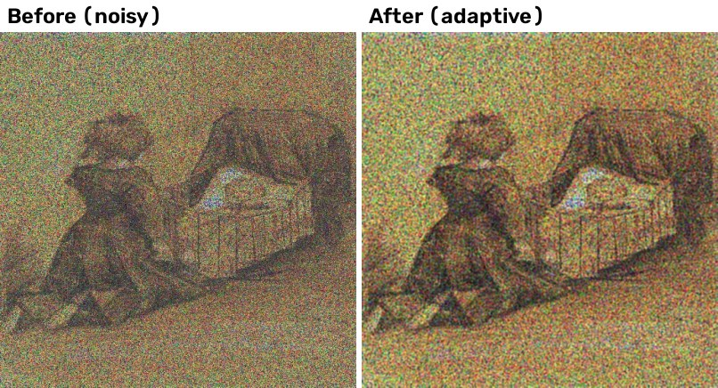
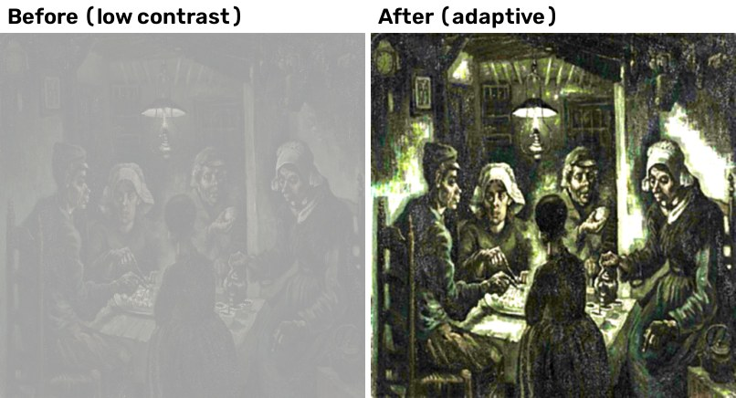
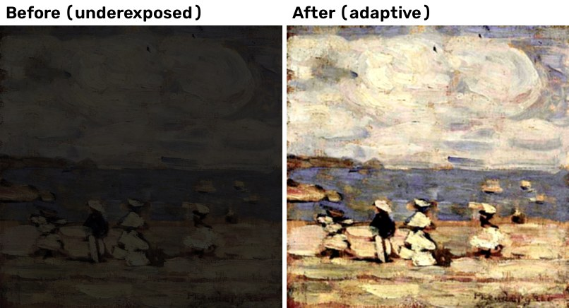

# Adaptive Art Restoration Using Digital Image Processing

An adaptive image restoration pipeline that measures brightness, contrast and noise, then chooses which classical corrections to apply. It uses no machine learning: every step is a hand-written OpenCV / scikit-image operation with fixed thresholds.

**Live demo:** _add Streamlit URL_ (free hosting sleeps when idle, so the first load can take a minute)

## How it works

The input image goes through measurements, then conditional corrections, then an unconditional sharpen. Steps run in a fixed order, and each measurement is taken on the image as corrected so far.

### Decision table

| Step | Measurement (8-bit, all channels) | Trigger | Correction | Parameters |
|---|---|---|---|---|
| 1 | Mean brightness | mean < 50 | Gamma correction | γ = 1.5 (brightens) |
| 2 | Contrast (standard deviation) | std < 50 | Contrast stretching | 2nd–98th percentile mapped to 0–255 |
| 3 | Mean brightness | mean < 128 | Dehazing (dark channel prior) | ω = 0.95, 15×15 patch, t₀ = 0.1, airlight from brightest 0.1% of dark-channel pixels |
| 4 | Global SNR = mean / std | SNR < 4.0 | Noise reduction (Gaussian blur) | 5×5 kernel, σ = 0 (auto) |
| 5 | — | always | Sharpening (unsharp mask) | σ = 1.0, strength 1.5 |

Step 3 is triggered by a brightness check, not by a haze measurement. Any image with mean below 128 gets dehazed, so the step is closer to a second tone correction than to haze removal.

### Which branches fire on the sample images

| Image | Input mean | Input std | Steps applied |
|---|---|---|---|
| `11.jpg` | 24.8 | 10.3 | gamma, stretch, dehaze, denoise, sharpen |
| `21.jpg` | 32.1 | 10.0 | gamma, stretch, denoise, sharpen |
| `26.jpg` | 164.6 | 5.3 | stretch, dehaze, denoise, sharpen |
| `3.jpg` | 109.0 | 42.6 | stretch, dehaze, denoise, sharpen |
| `14.jpg` | 121.8 | 53.4 | dehaze, denoise, sharpen |
| `old_photo_07.jpg` | 163.1 | 47.0 | stretch, denoise, sharpen |
| `old_photo_09.jpeg` | 117.6 | 52.1 | dehaze, denoise, sharpen |

On all seven samples the SNR after step 3 is between 1.2 and 2.7, so the denoise step fires on every image. See [Limitations](#limitations).

## Before / after

**Noise.** `3.jpg`. The after image is only partly denoised: the 5×5 blur is weak against this grain, and sharpening then re-emphasises what is left.



**Low contrast.** `26.jpg`. The stretch recovers most of the tonal range. The result has a visible yellow-green colour cast.



**Underexposed.** `21.jpg`. Gamma correction and stretching lift the scene; this is the clearest success on the samples.



## Evaluation (synthetic degradations)

To get a reference, `evaluate.py` starts from clean images (four of scikit-image's bundled samples: astronaut, chelsea, coffee, rocket), applies a known degradation, restores the result, and compares it with the clean original.

- **PSNR** (dB, higher is better) and **SSIM** (0–1, higher is better) are computed against the clean reference.
- *in* = degraded input vs clean; *out* = restored output vs clean.
- Each row averages the four reference images. Noise uses a fixed seed (0).

| Degradation | n | PSNR in | PSNR out | Δ PSNR | SSIM in | SSIM out | Δ SSIM |
|---|---|---|---|---|---|---|---|
| Underexposed (×0.35) | 4 | 10.84 | 12.56 | +1.72 | 0.520 | 0.704 | +0.184 |
| Low contrast (×0.3 + mid-grey) | 4 | 14.71 | 12.25 | −2.45 | 0.643 | 0.715 | +0.071 |
| Haze (I = Jt + A(1−t), t = 0.5, A = 230) | 4 | 10.97 | 13.06 | +2.09 | 0.676 | 0.738 | +0.062 |
| Gaussian noise (σ = 25) | 4 | 20.60 | 18.30 | −2.30 | 0.308 | 0.513 | +0.205 |
| Underexposed + noise (σ = 15) | 4 | 10.65 | 17.02 | +6.37 | 0.218 | 0.358 | +0.140 |

Reading the table:

- SSIM improves in all five cases.
- PSNR drops for low contrast and for pure noise. The stretch changes absolute intensities, and sharpening amplifies noise. PSNR is pixel-wise, so it penalises both. SSIM compares local structure and is less sensitive to these effects.
- Four reference images and five degradations is a small benchmark. These numbers show direction, not precise gains.

Reproduce with:

```bash
pip install -r requirements.txt
python evaluate.py      # about 20 seconds
```

## Limitations

- **Classical methods only.** Every step is a fixed mathematical operation. The pipeline cannot use learned priors about what artworks or faces should look like.
- **No inpainting.** Scratches, cracks, losses, stains and foxing are not detected or filled. The pipeline changes global tone and applies a blur and a sharpen, so local damage is left as it is.
- **Hand-tuned thresholds.** The values 50, 128 and 4.0 were chosen by looking at a small set of seven images. They have not been validated on a held-out set, and a change in any threshold changes which branches fire.
- **Global measurements.** The "SNR" is the mean divided by the standard deviation of the whole image. That mixes scene content with noise, and in practice it is around 1–3 for every sample, so denoising always runs. Step 3 reads brightness as haze, so a genuinely dark night scene is treated as hazy.
- **Order dependence.** Each step sees the output of the previous one. Gamma changes the mean and std that the later checks read.
- **Denoising is not edge-aware.** A global Gaussian blur smooths edges and texture along with the noise. Sharpening then amplifies residual grain (see the noise example and the PSNR drop above).
- **Global colour operations.** Gamma and stretching act on the whole image, with no per-region control. This can produce colour casts, as in the low-contrast example.
- **No reference for real artworks.** The benchmark uses synthetic degradations of photographs. Real aged prints have degradations that are not modelled here, and there is no ground-truth restoration to score against.
- **8-bit input only.** Images are converted to 8-bit RGB; higher bit depths are not handled.

## Running it

**Streamlit app (local):**

```bash
pip install -r requirements.txt
streamlit run streamlit/app.py
```

**Notebook:** open `restoration.ipynb`. It contains the same pipeline as `streamlit/restore.py`, with the sample images as Windows paths.

The hosted app is built from `streamlit/requirements.txt` (unpinned) and `streamlit/packages.txt` (system packages).

## Project layout

```
streamlit/app.py       Streamlit UI (upload, run, processing log)
streamlit/restore.py   Pipeline functions and adaptive_restoration()
restoration.ipynb      Notebook version of the pipeline, with sample runs
evaluate.py            Synthetic PSNR / SSIM benchmark
images/                Sample inputs
results/               Outputs from the notebook run
docs/                  Before / after figures used in this README
requirements.txt       Pinned local dependencies (Python 3.14 tested)
LICENSE                MIT
```

## License

MIT. See [LICENSE](LICENSE).
